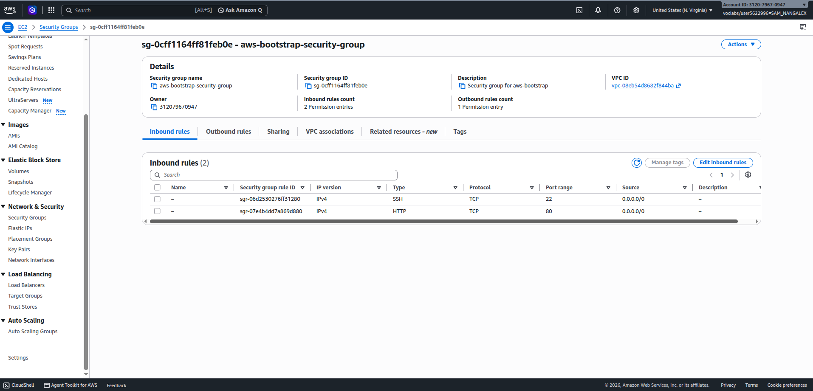
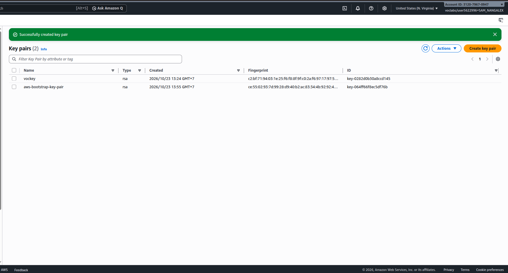
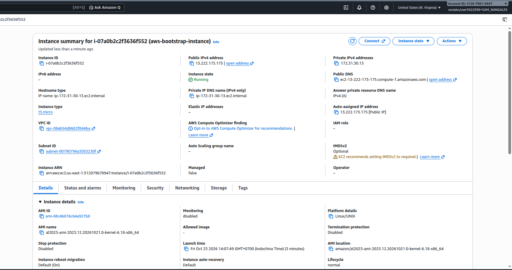
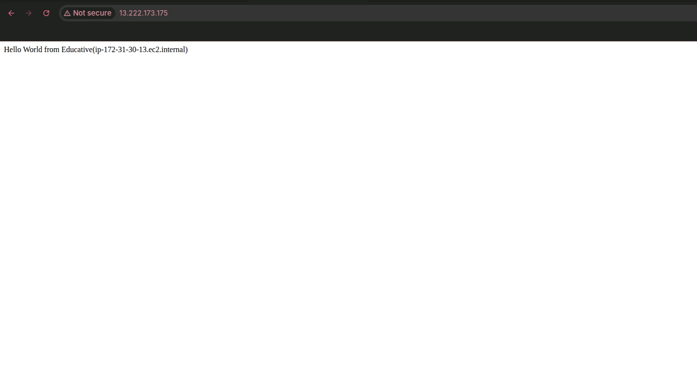
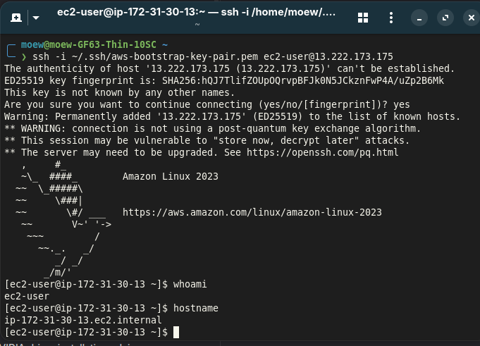
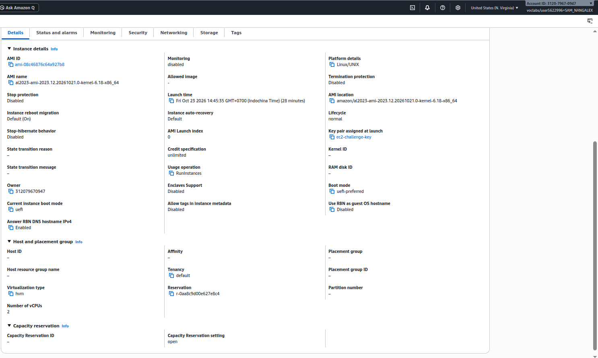
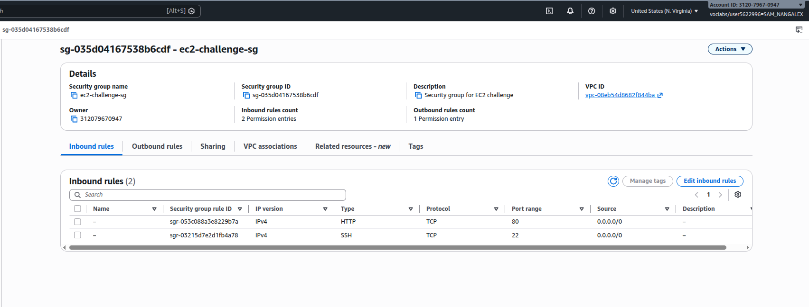
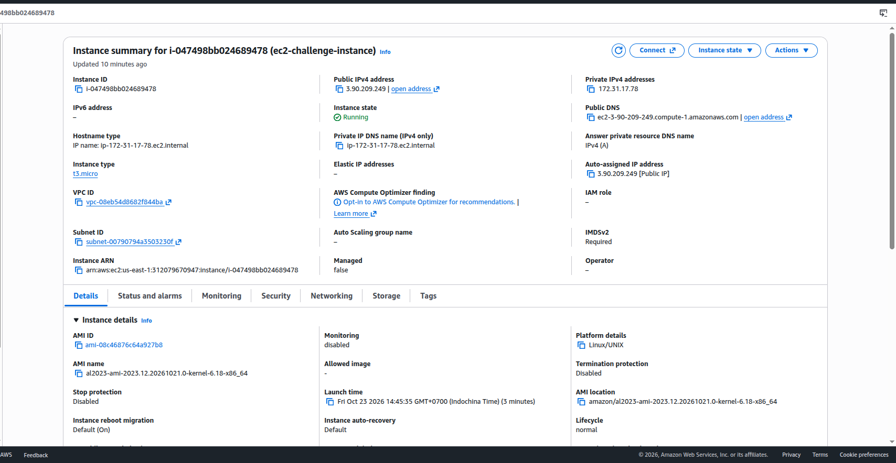
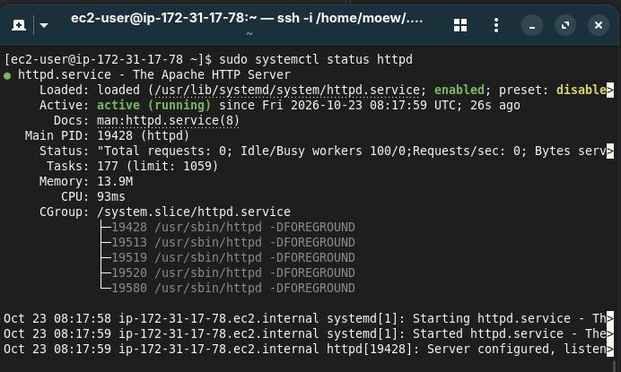
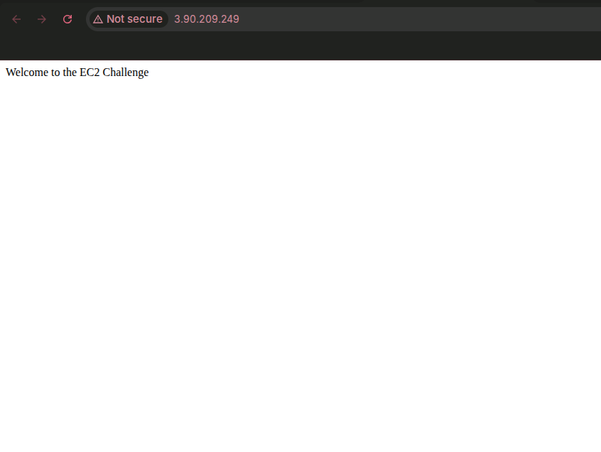

# Cloud Lab 1 — Amazon EC2

**Student ID:** e20220253  

**Name:** Sam Nangalex

## Part 1.1 — Amazon EC2 Walkthrough

### 1. Create a Security Group

### 2. Create a Key Pair

### 3. Launch an EC2 Instance

### 4. Test the Web Server

### 5. Connect to EC2 Using SSH

---

## Part 1.2 — EC2 Web Solution Challenge

### 6. Launch Configuration

### 7. Configure Security Group

### 8. Launch and Verify EC2 Instance

### 9. Install Web Server and Create HTML Page

### 10. Test the Challenge Website

