# Cloud Lab 2 — Load Balancing and Auto Scaling

**Student ID:** e20220253  
**Name:** Sam Nangalex

## Part 1 — Load Balancing and Auto Scaling

### 1. Create a Security Group for the Load Balancer

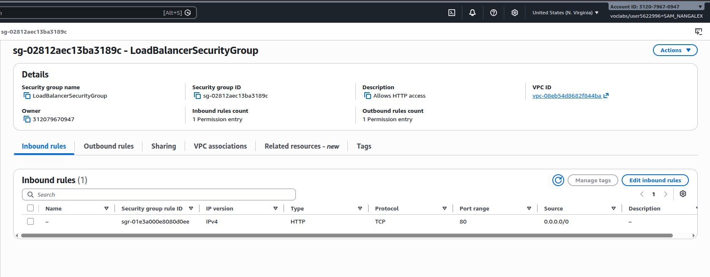

### 2. Create a Security Group for the EC2 Instances

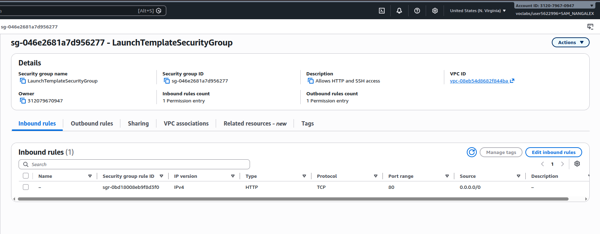

### 3. Create a Target Group

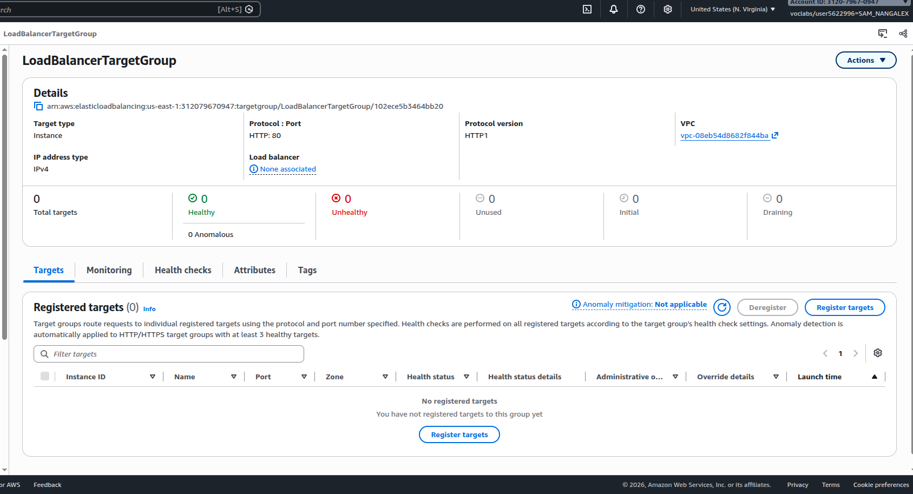

### 4. Configure Target Group Health Checks

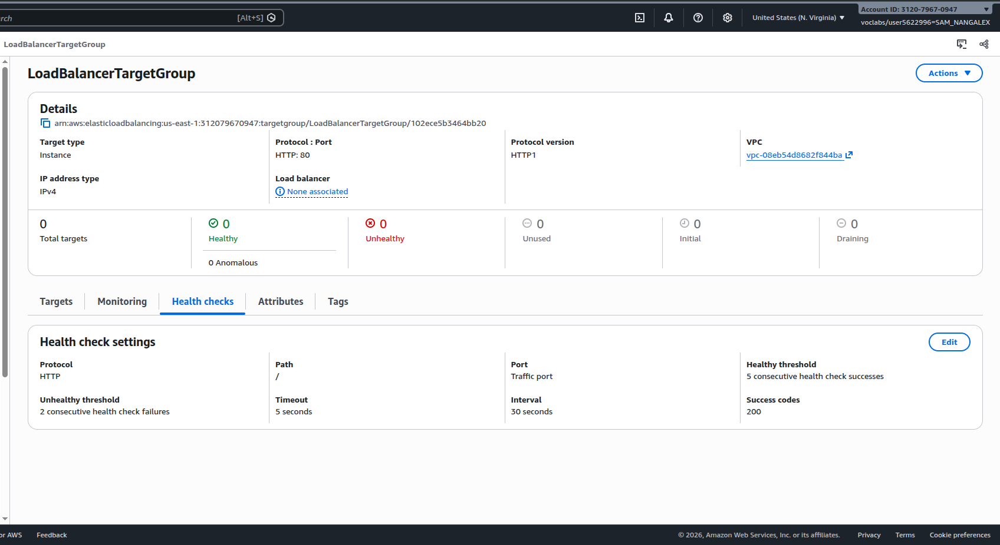

### 5. Review the Load Balancer List

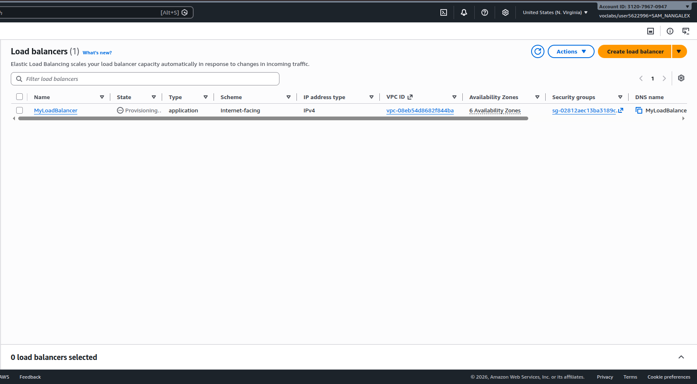

### 6. Review the Load Balancer Details

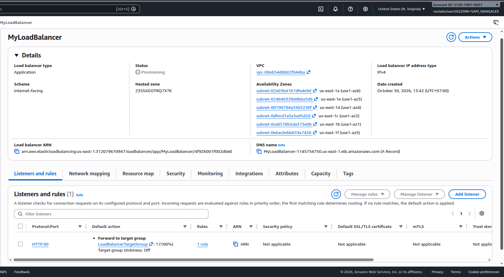

### 7. Create a Launch Template

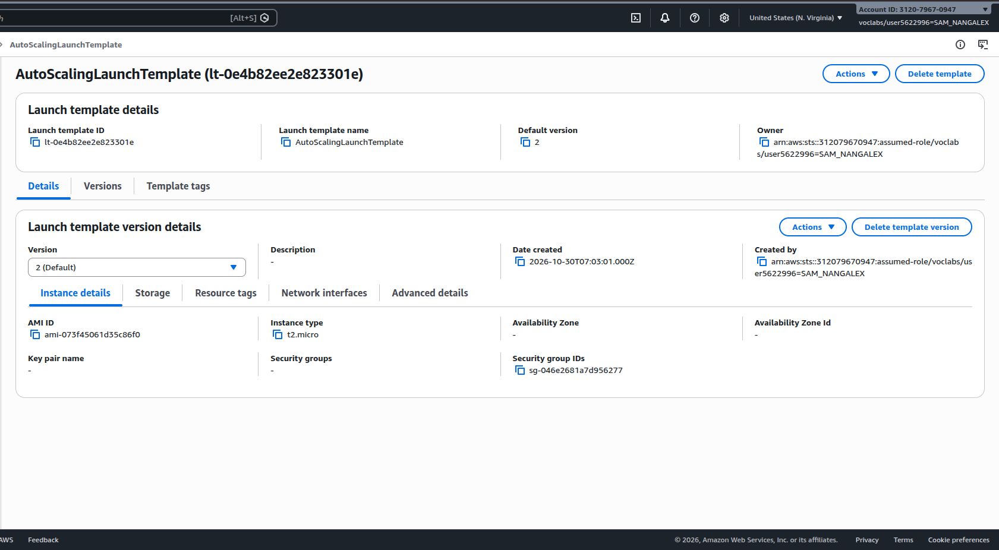

### 8. Review the Auto Scaling Group List

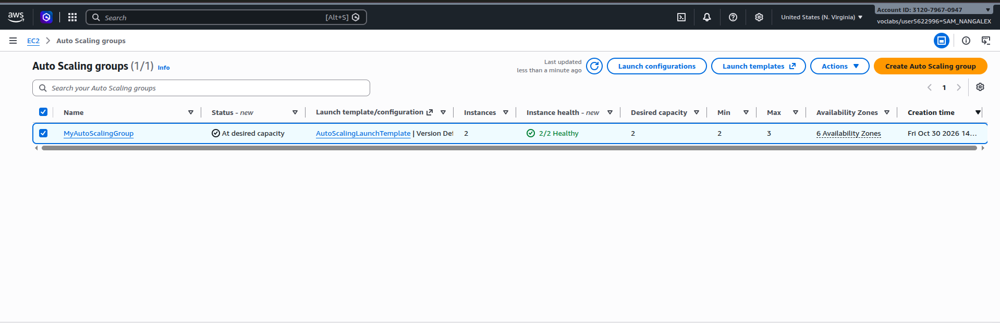

### 9. Review the Auto Scaling Group Details

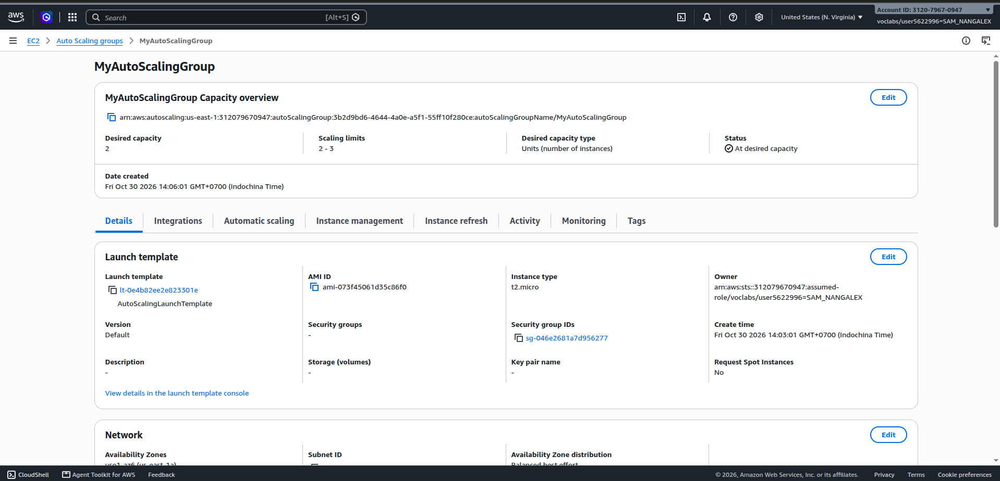

### 10. Test the Website in a Browser

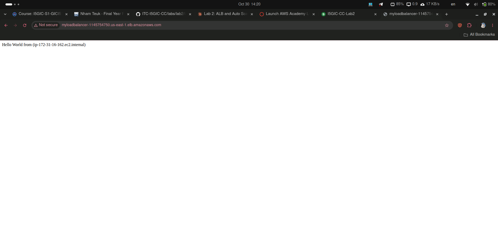

### 11. Test the Website Again

### 12. Stop the HTTP Service

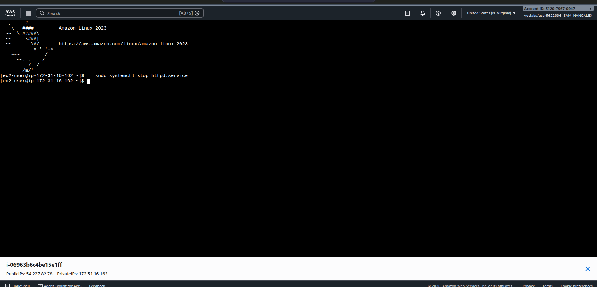

### 13. Confirm the Target Is Unhealthy

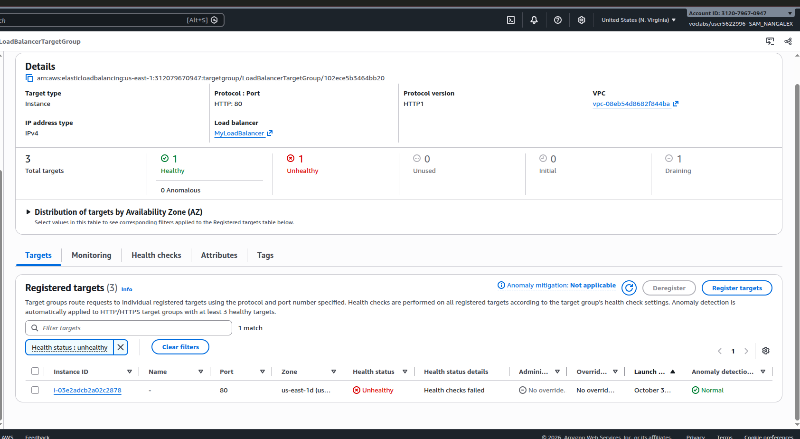

### 14. Confirm the Replacement Target

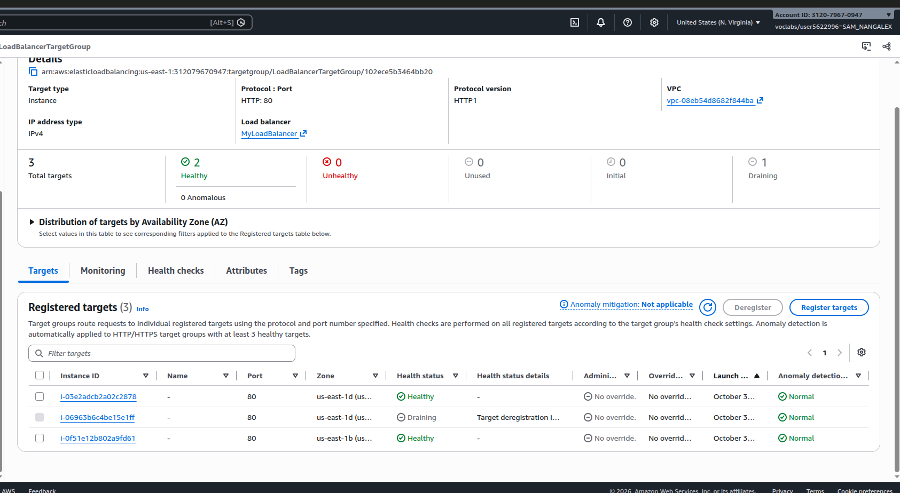

