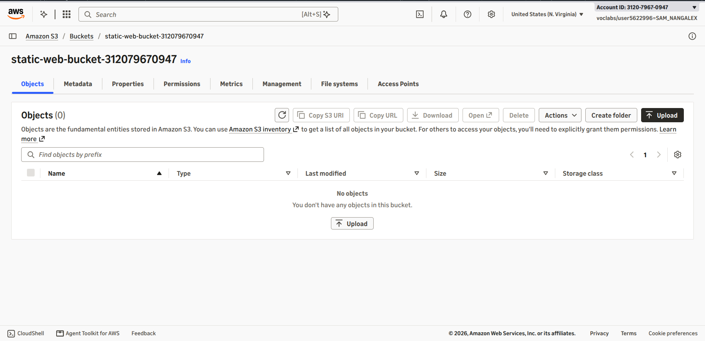
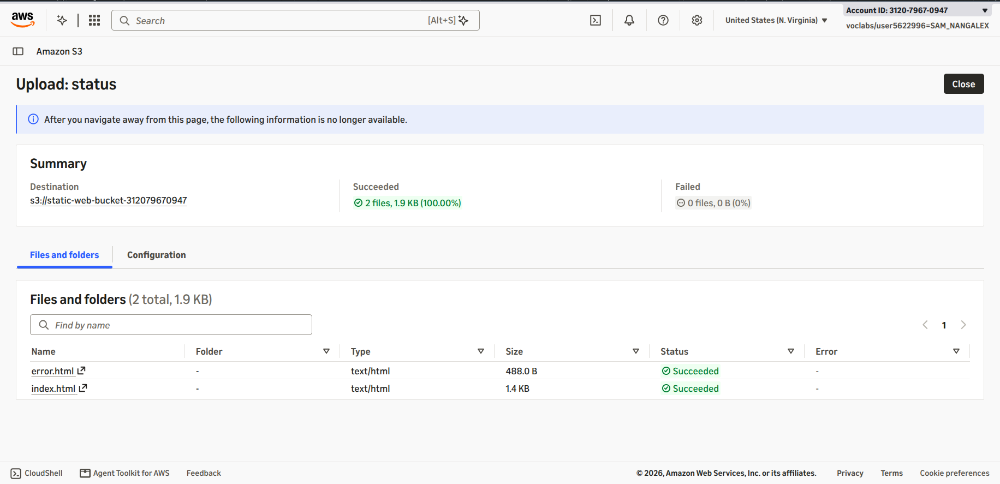
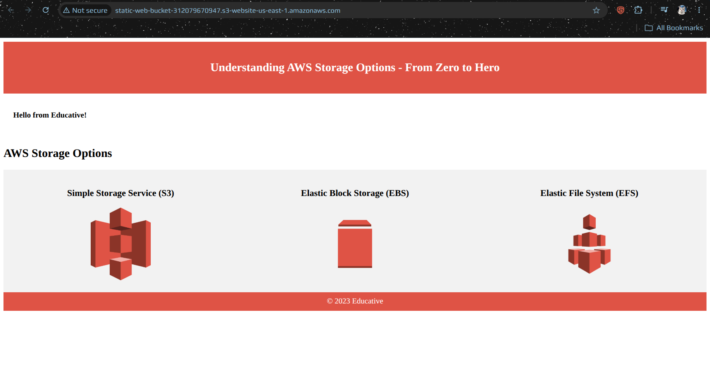
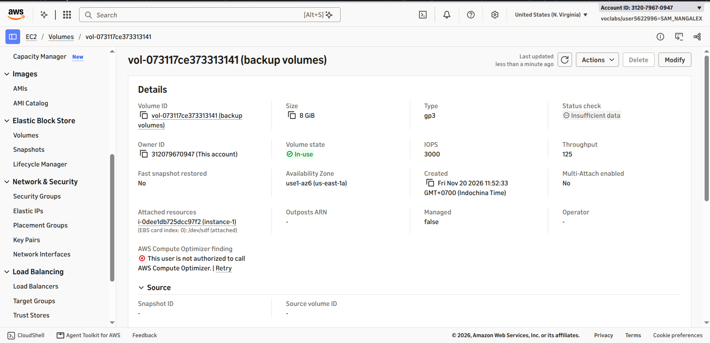
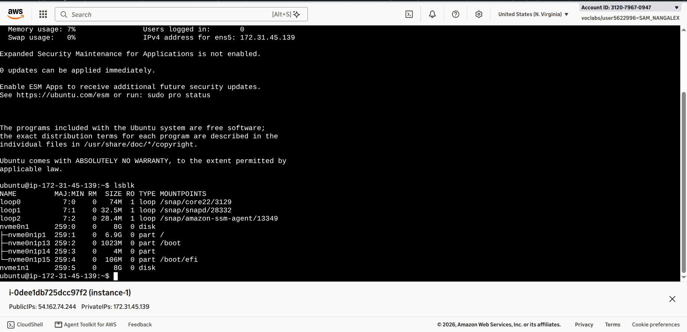
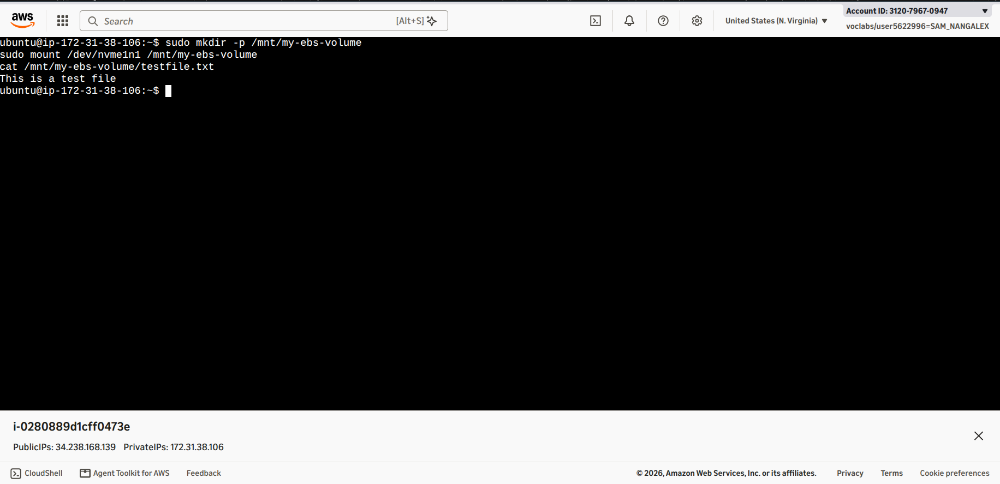
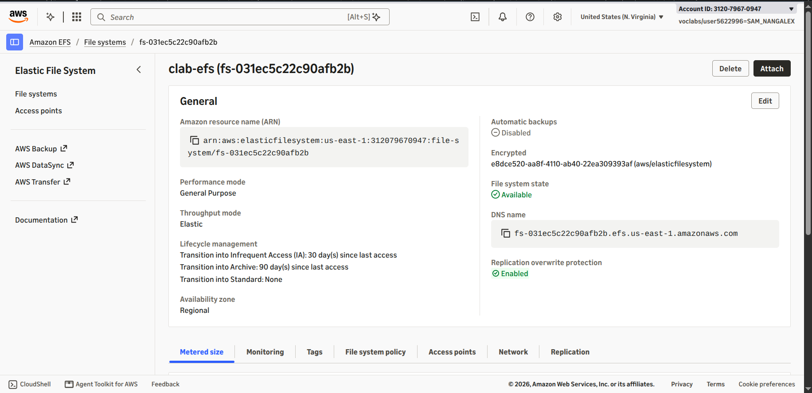
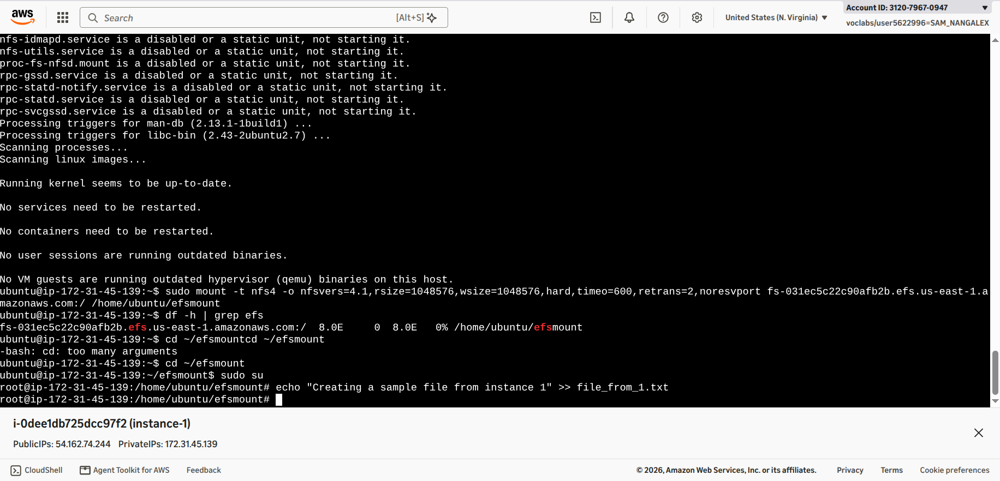
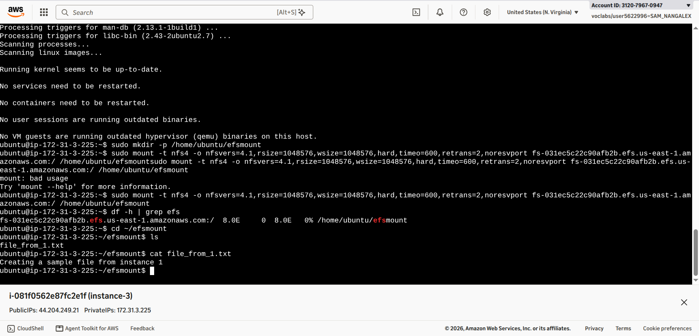

# Cloud Lab 3 — AWS Storage: S3, EBS, and EFS

| Item | Details |
|---|---|
| Student name | Sam Nangalex |
| Student ID | e20220253 |

## Objective

Explore three AWS storage services: host a static website with Amazon S3, attach and inspect an Amazon EBS volume, and share files between instances with Amazon EFS.

## 1. Amazon S3

Created an S3 bucket named `<bucket name>` in `<your AWS Region>` and uploaded the website files. Configured static website hosting and tested the website endpoint.

## 2. Amazon EBS

Attached an EBS volume to the first EC2 instance and checked the block devices with `lsblk`. Record the volume size and device or mount details used: `
`.

Attached the volume to a second EC2 instance and verified that the volume was available there.

## 3. Amazon EFS

Created an EFS file system named `<file system name>` and connected it to the EC2 instances. Record the mount path and connection method: `
`.

Created a test file on the mounted EFS file system from one instance:

Read the same file from another instance to verify that the shared file system is accessible:

## Summary

This lab demonstrated object storage and static website hosting with S3, block storage with EBS, and shared network file storage with EFS. Replace the angle-bracketed fields with the resource details from your lab before submitting.