# Cloud Lab 4 — Amazon VPC with Public and Private Subnets

| Item | Details |
|---|---|
| Student name | Sam Nangalex |
| Student ID | e2022053 |
| AWS Region | US East (N. Virginia) (`us-east-1`) |

### 1. VPC

Created `lab4-vpc` with IPv4 CIDR `10.0.0.0/24`.

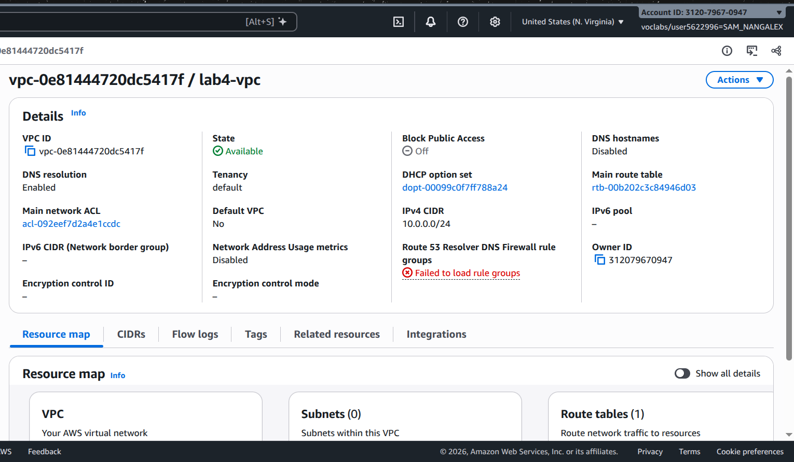

### 2. Internet gateway

Created `lab4-internet-gateway` and attached it to `lab4-vpc`.

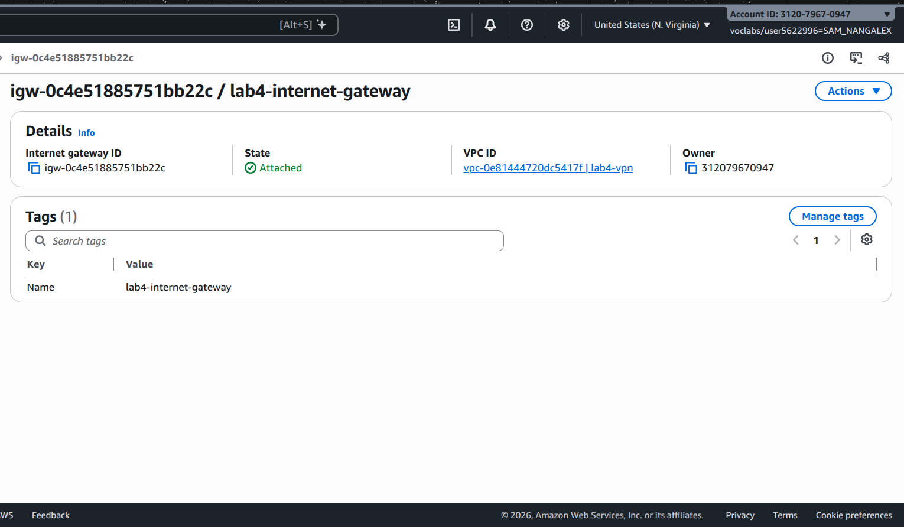

### 3. Public subnet

Created `lab4-public-subnet` with CIDR `10.0.0.0/25` in `us-east-1a`.

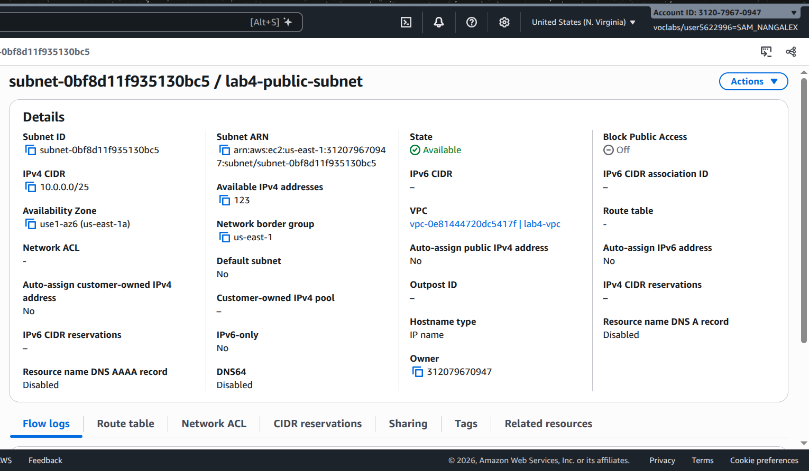

### 4. Public route table

Configured the public subnet route table with `0.0.0.0/0` pointing to `lab4-internet-gateway` and associated it with the public subnet.

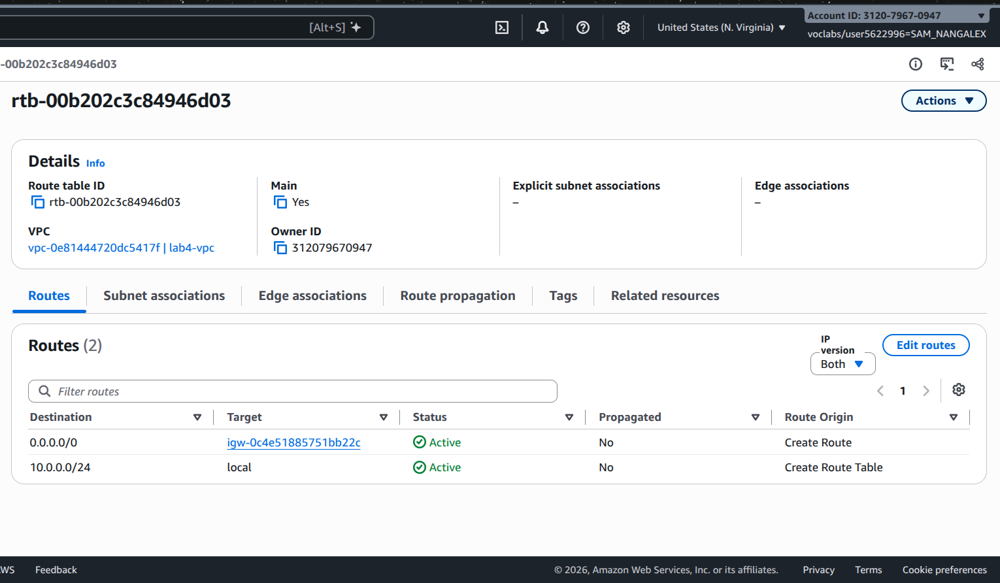

### 5. Public EC2 instance

Launched `lab4-ec2-01` in `lab4-public-subnet` with a public IPv4 address and the `LabInstanceProfile` instance profile.

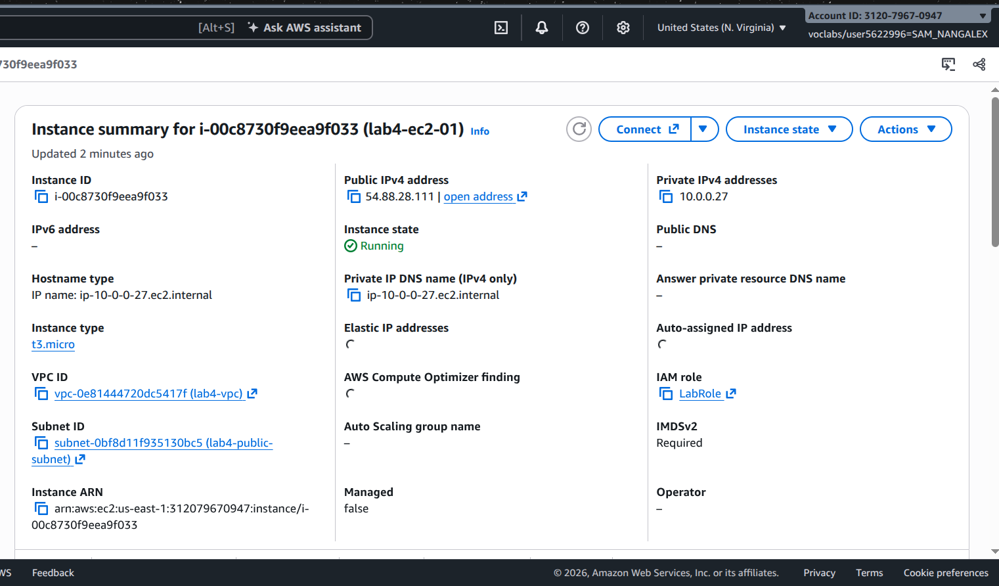

### 6. Public instance connectivity test

Ran `sudo yum update -y` on `lab4-ec2-01` using Systems Manager Run Command. The command completed successfully.

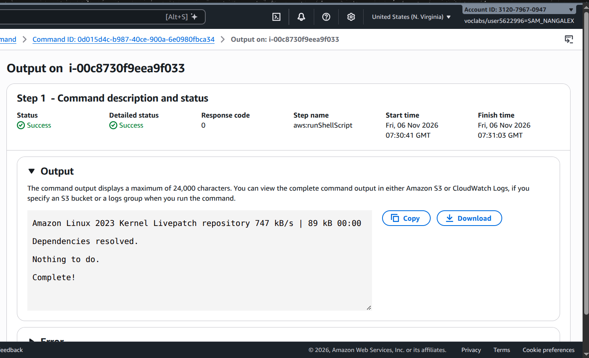

### 7. Private subnet

Created `lab4-private-subnet` with CIDR `10.0.0.128/25` in `us-east-1a`.

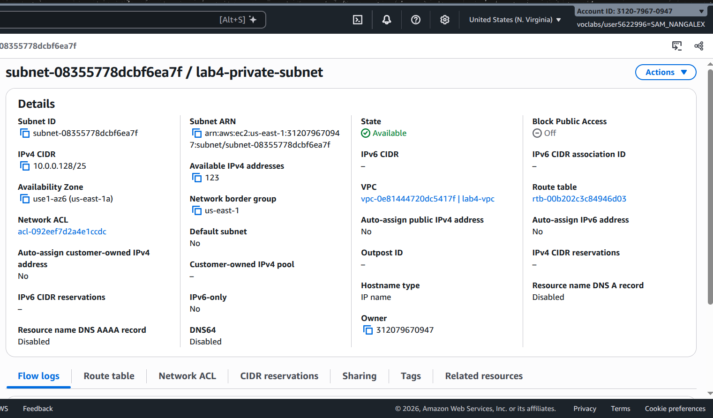

### 8. NAT gateway

Created `lab4-nat-gateway` in `lab4-public-subnet` and allocated an Elastic IP. Waited for the NAT gateway to become available.

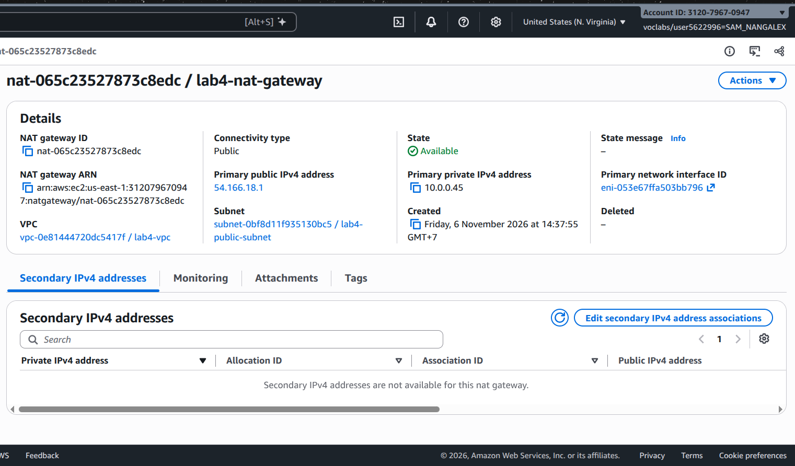

### 9. Private route table

Created `lab4-custom-route-table`, added `0.0.0.0/0` pointing to `lab4-nat-gateway`, and associated it with `lab4-private-subnet`.

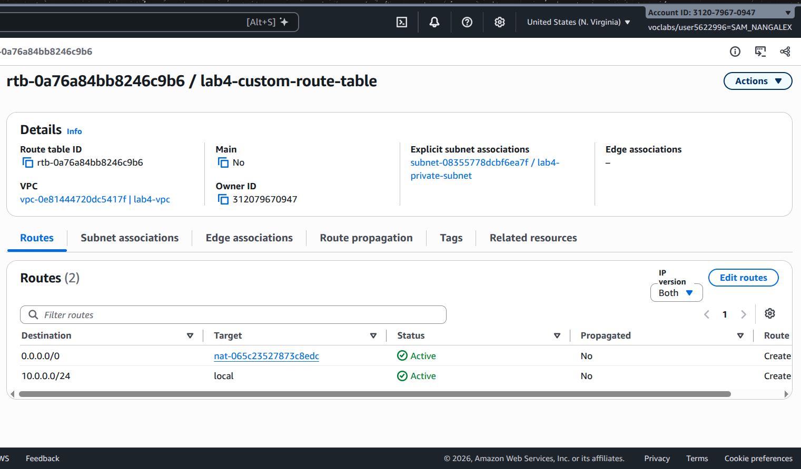

### 10. Private EC2 instance

Launched `lab4-ec2-02` in `lab4-private-subnet` with auto-assigned public IP disabled and the `LabInstanceProfile` instance profile.

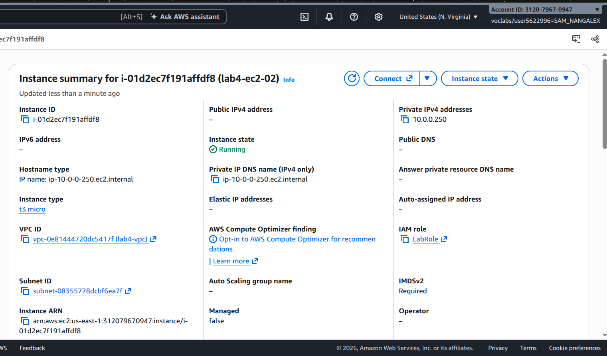

### 11. Private instance connectivity test

Ran `sudo yum update -y` on `lab4-ec2-02` using Systems Manager Run Command. The command completed successfully through the NAT gateway, although the instance has no public IP address.

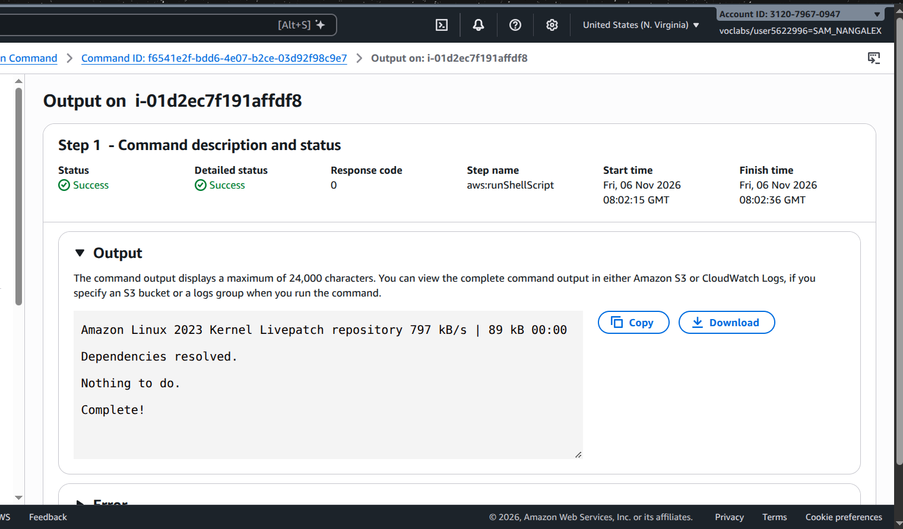

